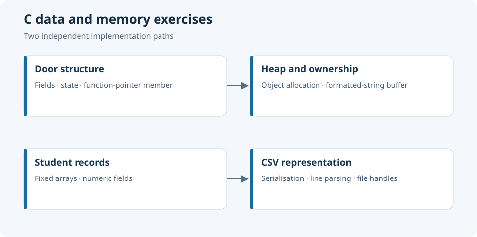

# C Programming — Memory, Data Structures and File I/O

C exercises in pointers, heap allocation, function pointers and CSV file processing.



*Two independent implementation paths.*

## Modules

| Location | Scope |
|---|---|
| [`exercices/`](exercices/) | Vector statistics and student-record CSV exercises |
| [`structure_porte/porte.c`](structure_porte/porte.c) | Heap-allocated structures, state mutation, comparison and a function-pointer field |
| [Separate stock-management project](https://github.com/tedjelmoulksn-dotcom/Gestion-du-stock-en-C) | Larger C data-management exercise with its own technical README |

## Low-level concepts

The door example models state using a `struct Porte`, stores a colour in a fixed ten-byte array and allocates objects with `malloc`. A function-pointer member provides an explicit operation associated with the object.

Formatting returns another heap-allocated buffer. This makes ownership and lifetime visible: callers must decide who releases returned strings and objects. Pointer identity and field equality are separate questions; the supplied equality function compares dimensions and colour, but not the open/closed state.

## Building the structure exercise

With a C compiler installed:

```bash
git clone https://github.com/tedjelmoulksn-dotcom/Programmation_C.git
cd Programmation_C
mkdir -p build
cc -std=c11 -Wall -Wextra -Wpedantic -g structure_porte/porte.c -o build/porte
./build/porte
```

For investigation, add AddressSanitizer/UndefinedBehaviorSanitizer flags if supported by your compiler. They help inspect memory behaviour; they do not certify the application.

## Source review

The key review criterion is object lifetime: every allocation needs one owner, every returned buffer needs a release policy, and every fixed-size field needs an input bound. Compiler diagnostics and memory instrumentation make these relationships inspectable during execution.

The exercises expose several important C design decisions:

- `strcpy` into fixed buffers needs an explicit input-length bound.
- Object and formatted-string allocations need checked failures and matching `free` calls.
- `standardPorte()` does not initialise the function-pointer member.
- The CSV exercise contains incompatible pointer types and an incomplete record-reading path; review it before using it with real data.
- The student-record exercise writes a `database.csv` file in its working directory.

The learning value is in tracing these operations from the data model to memory accesses, then defining explicit ownership and bounds at each interface.

## Licence

No project-wide licence has been defined.
